<a href="https://claudiomeireles.vercel.app">
  <picture>
    <source media="(prefers-color-scheme: dark)" srcset="assets/readme/hero-noite.svg">
    <source media="(prefers-color-scheme: light)" srcset="assets/readme/hero-papel.svg">
    
  </picture>
</a>

<p align="center">
  <a href="https://claudiomeireles.vercel.app">portfólio ↗</a>&nbsp;&nbsp;·&nbsp;&nbsp;<a href="https://www.linkedin.com/in/cgfm1">linkedin ↗</a>&nbsp;&nbsp;·&nbsp;&nbsp;<a href="mailto:cmeireles756@gmail.com">email ↗</a>&nbsp;&nbsp;·&nbsp;&nbsp;<a href="./Curriculo-Claudio-Meireles.pdf">currículo ↓</a>
</p>

<br>

<picture>
  <source media="(prefers-color-scheme: dark)" srcset="assets/readme/section-whoami-noite.svg">
  <source media="(prefers-color-scheme: light)" srcset="assets/readme/section-whoami-papel.svg">
  
</picture>

<picture>
  <source media="(prefers-color-scheme: dark)" srcset="assets/readme/whoami-noite.svg">
  <source media="(prefers-color-scheme: light)" srcset="assets/readme/whoami-papel.svg">
  
</picture>

Estudante de Ciência da Computação no IDP e **tech lead da VM Medicina e Saúde Mental**, uma clínica psiquiátrica em Brasília. Backend, dados e IA aplicada: da coleta de dados à API, do processamento em tempo real à interface de quem usa.

<br>

<picture>
  <source media="(prefers-color-scheme: dark)" srcset="assets/readme/section-projetos-noite.svg">
  <source media="(prefers-color-scheme: light)" srcset="assets/readme/section-projetos-papel.svg">
  
</picture>

<table>
<tr>
<td width="50%" valign="top">
<a href="https://github.com/ClaudioAMF1/AEGIS">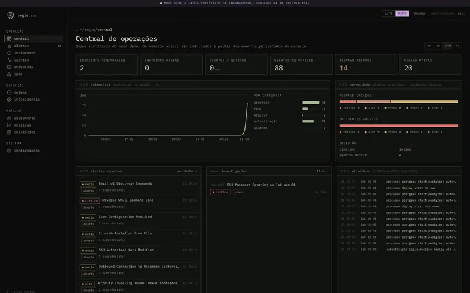</a>
<br><sub>01 / CIBERSEGURANÇA · SOC · IA</sub>
<br><b><a href="https://github.com/ClaudioAMF1/AEGIS">AEGIS</a></b> — defesa cibernética autônoma
<br><br>Agente Linux em Rust, pipeline com Redis Streams, detecção compatível com Sigma e MITRE ATT&amp;CK, e um console onde um analista de IA cita as evidências de cada caso.
<br><br><sub>~1,1 mil eventos/s · 111 testes na API · E2E com Playwright</sub>
<br><code>Rust</code> <code>FastAPI</code> <code>Next.js</code> <code>PostgreSQL</code> <code>Redis</code>
</td>
<td width="50%" valign="top">
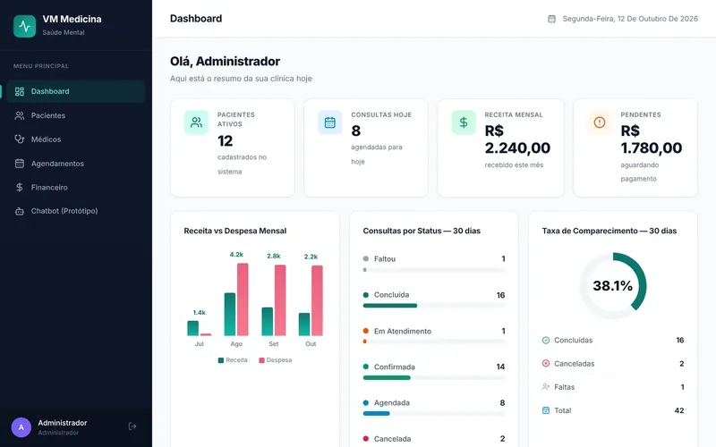
<br><sub>02 / HEALTHTECH · LGPD · IA APLICADA</sub>
<br><b>Gestão Clínica — VM Medicina</b> <sub>· privado</sub>
<br><br>Sistema interno da clínica onde atuo como tech lead: pacientes, agenda e financeiro, com a privacidade dos pacientes como requisito de arquitetura.
<br><br><sub>RBAC + auditoria (LGPD) · HMAC-SHA256 + k-anonimato · 34 testes</sub>
<br><code>FastAPI</code> <code>React</code> <code>PostgreSQL</code> <code>scikit-learn</code> <code>Docker</code>
</td>
</tr>
<tr>
<td width="50%" valign="top">
<a href="https://github.com/ClaudioAMF1/CAMF">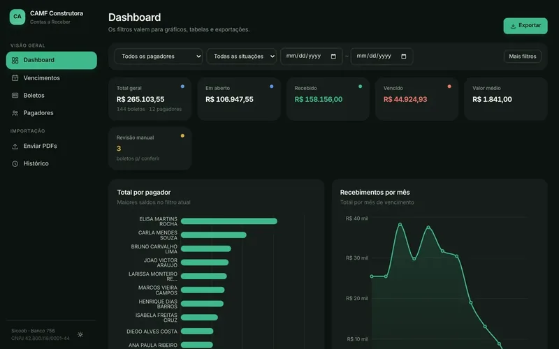</a>
<br><sub>03 / FINTECH · AUTOMAÇÃO · CLIENTE REAL</sub>
<br><b><a href="https://github.com/ClaudioAMF1/CAMF">CAMF</a></b> — contas a receber
<br><br>Transforma PDFs de boletos Sicoob numa base auditável. Cada boleto é conferido contra a própria linha digitável; qualquer divergência vai para revisão manual.
<br><br><sub>módulo 10 e 11 · FEBRABAN 2025 · auditoria append-only</sub>
<br><code>Python</code> <code>pdfplumber</code> <code>Docker</code> <code>Render</code>
</td>
<td width="50%" valign="top">
<a href="https://github.com/ClaudioAMF1/IDP-Scoutlink">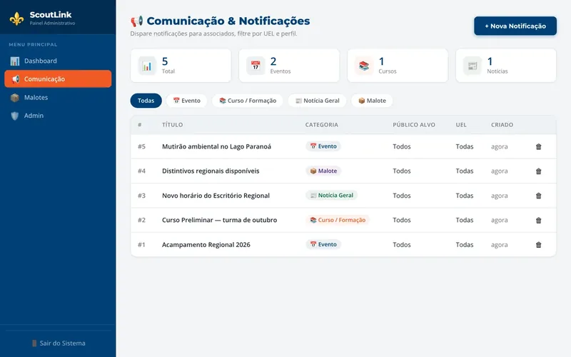</a>
<br><sub>04 / MOBILE · WEB · IMPACTO SOCIAL</sub>
<br><b><a href="https://github.com/ClaudioAMF1/IDP-Scoutlink">ScoutLink</a></b> — escoteiros do DF
<br><br>App para os associados, painel para a equipe regional e uma API compartilhada: avisos segmentados, mapa dos grupos, chamados com chat e termo de autorização digital.
<br><br><sub>notificações por perfil e grupo · chat em tempo real · PDF do TAAEC</sub>
<br><code>Expo</code> <code>React</code> <code>FastAPI</code> <code>PostgreSQL</code>
</td>
</tr>
<tr>
<td width="50%" valign="top">
<picture>
  <source media="(prefers-color-scheme: dark)" srcset="assets/readme/card-legitrack-noite.svg">
  <source media="(prefers-color-scheme: light)" srcset="assets/readme/card-legitrack-papel.svg">
  
</picture>
<br><sub>05 / CIVIC TECH · MOBILE · DADOS ABERTOS</sub>
<br><b>LegiTrack</b> — projetos de lei <sub>· privado</sub>
<br><br>Acompanha a tramitação de PLs na Câmara: um worker consulta a API de dados abertos e avisa quem favoritou cada projeto quando há movimentação.
<br><br><sub>feed por interesse · busca em tempo real · feito em dupla</sub>
<br><code>Flutter</code> <code>Flask</code> <code>PostgreSQL</code> <code>JWT</code>
</td>
<td width="50%" valign="top">
<a href="https://github.com/ClaudioAMF1/crypto-analytics-pipeline"><picture>
  <source media="(prefers-color-scheme: dark)" srcset="assets/readme/card-crypto-pipeline-noite.svg">
  <source media="(prefers-color-scheme: light)" srcset="assets/readme/card-crypto-pipeline-papel.svg">
  
</picture></a>
<br><sub>06 / BIG DATA · MICROSSERVIÇOS</sub>
<br><b><a href="https://github.com/ClaudioAMF1/crypto-analytics-pipeline">Pipeline de Criptomoedas</a></b>
<br><br>Coleta, processamento e análise em tempo real numa arquitetura de microsserviços, com orquestração de workflows e dashboard interativo.
<br><br><sub>~500 msg/s · latência &lt; 100 ms · uptime 99,9%</sub>
<br><code>Kafka</code> <code>MongoDB</code> <code>Redis</code> <code>Airflow</code> <code>Streamlit</code>
</td>
</tr>
<tr>
<td width="50%" valign="top">
<a href="https://github.com/ClaudioAMF1/soccer-video-analytics"><picture>
  <source media="(prefers-color-scheme: dark)" srcset="assets/readme/card-soccer-vision-noite.svg">
  <source media="(prefers-color-scheme: light)" srcset="assets/readme/card-soccer-vision-papel.svg">
  
</picture></a>
<br><sub>07 / COMPUTER VISION · MACHINE LEARNING</sub>
<br><b><a href="https://github.com/ClaudioAMF1/soccer-video-analytics">Análise Tática de Futebol</a></b>
<br><br>Detecção e rastreamento de jogadores e bola, mapas de calor, análise de formações e métricas de desempenho.
<br><br><sub>tempo real a 30 FPS · melhor Scrum Master do projeto</sub>
<br><code>YOLOv8</code> <code>Norfair</code> <code>OpenCV</code> <code>NumPy</code>
</td>
<td width="50%" valign="top">
<a href="https://github.com/ClaudioAMF1/TCC"><picture>
  <source media="(prefers-color-scheme: dark)" srcset="assets/readme/card-tcc-pesquisa-noite.svg">
  <source media="(prefers-color-scheme: light)" srcset="assets/readme/card-tcc-pesquisa-papel.svg">
  
</picture></a>
<br><sub>08 / PESQUISA · PRIVACIDADE · EM ANDAMENTO</sub>
<br><b><a href="https://github.com/ClaudioAMF1/TCC">Quem mais está dentro do aplicativo?</a></b>
<br><br>Meu TCC: apps oficiais do governo embarcam SDKs de rastreamento que enviam identificadores de cidadãos ao exterior? Comparado com apps comerciais pareados.
<br><br><sub>396 apps de 71 órgãos · 38,4% com dados sensíveis (LGPD)</sub>
<br><code>MobSF</code> <code>Androguard</code> <code>Exodus</code> <code>AndroZoo</code>
</td>
</tr>
</table>

<sub><b>more/</b> &nbsp;—&nbsp; <a href="https://github.com/ClaudioAMF1/Artigo-Compiladores">artigo-compiladores</a> · <a href="https://github.com/ClaudioAMF1/Inteligencia-de-negocio">inteligencia-de-negocio</a> · <a href="https://github.com/ClaudioAMF1/air-quality-pipeline">air-quality-pipeline</a> · <a href="https://github.com/ClaudioAMF1/Trabalho-Pratico-Programacao-Concorrente">programacao-concorrente</a> · <a href="https://github.com/ClaudioAMF1/football_prediction">football-prediction</a> · <a href="https://github.com/ClaudioAMF1/Ambiente">ambiente</a></sub>

<br>

<picture>
  <source media="(prefers-color-scheme: dark)" srcset="assets/readme/section-stack-noite.svg">
  <source media="(prefers-color-scheme: light)" srcset="assets/readme/section-stack-papel.svg">
  
</picture>

<picture>
  <source media="(prefers-color-scheme: dark)" srcset="assets/readme/stack-noite.svg">
  <source media="(prefers-color-scheme: light)" srcset="assets/readme/stack-papel.svg">
  
</picture>

<br>

<picture>
  <source media="(prefers-color-scheme: dark)" srcset="assets/readme/section-trajetoria-noite.svg">
  <source media="(prefers-color-scheme: light)" srcset="assets/readme/section-trajetoria-papel.svg">
  
</picture>

```text
* 2026 — atual      Tech Lead / VM Medicina e Saúde Mental
│                   estruturação completa da área de tecnologia de uma clínica
│                   psiquiátrica: sistema de gestão clínica (FastAPI, React,
│                   PostgreSQL, Docker), LGPD com controle de acesso e auditoria,
│                   anonimização de dados, automação de relatórios e IA aplicada
│
* mar — ago 2025    Estagiário de TI / RBCIP
│                   banco PostgreSQL e interface web dos certificados da Carreta
│                   Digital, com APIs REST em Python e Flask — +8.000 alunos
│
* fev — jul 2024    Monitor de Cálculo I / IDP
│                   apoio aos alunos e material didático complementar
│
* 2023 — 2027       Ciência da Computação / IDP · 7º semestre
```

<sub><b>cursos-e-certificacoes/</b> &nbsp;—&nbsp; AWS Cloud Security Foundations · Scrum Master (IDP) · Python Avançado · JavaScript &amp; TypeScript · Machine Learning Fundamentals · Big Data &amp; NoSQL · iOS &amp; Swift · inglês fluente</sub>

<br>

<picture>
  <source media="(prefers-color-scheme: dark)" srcset="assets/readme/section-contato-noite.svg">
  <source media="(prefers-color-scheme: light)" srcset="assets/readme/section-contato-papel.svg">
  
</picture>

Um projeto, uma oportunidade ou uma boa conversa sobre tecnologia. Pode me chamar.

<table>
<tr><td><sub>email</sub></td><td><a href="mailto:cmeireles756@gmail.com">cmeireles756@gmail.com ↗</a></td></tr>
<tr><td><sub>linkedin</sub></td><td><a href="https://www.linkedin.com/in/cgfm1">linkedin.com/in/cgfm1 ↗</a></td></tr>
<tr><td><sub>portfólio</sub></td><td><a href="https://claudiomeireles.vercel.app">claudiomeireles.vercel.app ↗</a></td></tr>
<tr><td><sub>currículo</sub></td><td><a href="./Curriculo-Claudio-Meireles.pdf">Curriculo-Claudio-Meireles.pdf ↓</a></td></tr>
</table>

<br>

<picture>
  <source media="(prefers-color-scheme: dark)" srcset="assets/readme/footer-noite.svg">
  <source media="(prefers-color-scheme: light)" srcset="assets/readme/footer-papel.svg">
  
</picture>
